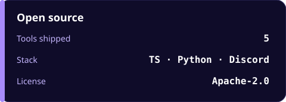
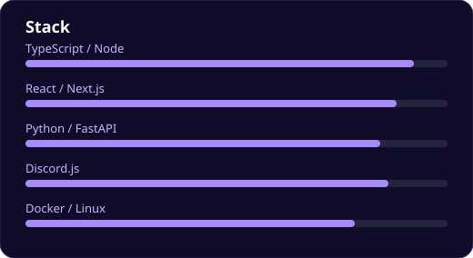
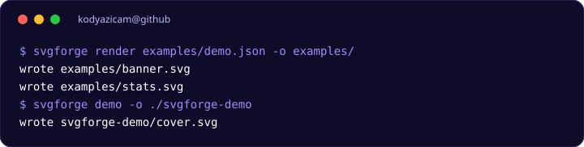

<p align="center">
  
</p>

<p align="center">
  <strong>Generate GitHub README SVGs on your machine.</strong><br/>
  Banners, stats, skills, terminals, badges, dividers, progress, donuts, charts, links, quotes, code, projects, waves, timelines, contribution graphs,   counters, sparklines, gauges, radars, columns, ratings, figures, marks, profiles, steps, pills, callouts, comparisons, social rows, checklists, and covers. No third-party render service.
</p>

<p align="center">
  <a href="https://github.com/KodYazicam/svgforge/actions"></a>
  
  
  
</p>

---

capsule-render, github-readme-stats, and typing SVGs look great until the CDN is down or the theme breaks. **svgforge** writes the same kind of cards as files you commit. GitHub serves them from your repo. No camo outage, no rate limit, no query-string theme API.

```bash
npm install -g @kodyazicam/svgforge
svgforge banner --title mytool --subtitle "Pack a codebase into LLM context" -o assets/banner.svg
```

You can also run it without a global install:

```bash
npx @kodyazicam/svgforge banner --title mytool -o assets/banner.svg
```

From another project, install the library:

```bash
npm install @kodyazicam/svgforge
```

```ts
import { banner } from "@kodyazicam/svgforge";
```

<p align="center">
  
  
</p>

<p align="center">
  
</p>

<p align="center">
  
  
</p>

<p align="center">
  
</p>

> **[ALL-SVG-FORMS.md](./ALL-SVG-FORMS.md)** — every card type as a rendered image, with the exact command and flags that produce it.

## Table of contents

- [Requirements](#requirements)
- [Install](#install)
- [Quick start](#quick-start)
- [Scaffold a project](#scaffold-a-project)
- [Preview locally](#preview-locally)
- [Card types](#card-types)
- [Themes](#themes)
- [Custom colors and layout](#custom-colors-and-layout)
- [CLI](#cli)
- [Manifest](#manifest)
- [Path confinement](#path-confinement)
- [Library](#library)
- [GitHub README usage](#github-readme-usage)
- [Escaping and limits](#escaping-and-limits)
- [Accessibility](#accessibility)
- [Troubleshooting](#troubleshooting)
- [FAQ](#faq)
- [License](#license)

## Requirements

- Node.js **22+**
- No canvas, no browser, no network

## Install

Global CLI:

```bash
npm install -g @kodyazicam/svgforge
svgforge banner --title hello -o banner.svg
```

One-off use:

```bash
npx @kodyazicam/svgforge banner --title hello -o banner.svg
```

Library:

```bash
npm install @kodyazicam/svgforge
```

From source:

```bash
git clone https://github.com/KodYazicam/svgforge.git
cd svgforge
npm ci
npm test
npm run build
node dist/cli.js banner --title hello -o banner.svg
# optional: npm link
```

## Quick start

```bash
svgforge init my-project
cd my-project
svgforge render svgforge.json -o assets
svgforge preview svgforge.json
```

Or render a single card anywhere:

```bash
svgforge banner --title myapp --subtitle "Catch webhooks" --theme tokyonight -o banner.svg
svgforge stats --item Stars=12 --item Forks=3 -o stats.svg
svgforge skills --item TypeScript=90 --item Python=80 --show-value -o skills.svg
svgforge terminal --line "$ myapp --port 4242" --line "listening" --caret -o term.svg
svgforge badge --label license --value Apache-2.0 --style plastic -o badge.svg
svgforge divider --label "more below" -o divider.svg
svgforge progress --value 68 --caption "roadmap" -o progress.svg
svgforge donut --item Code=55 --item Docs=30 --item Tests=15 --center 100% -o donut.svg
svgforge chart --item Mon=12 --item Tue=34 --item Thu=51 -o chart.svg
svgforge links --item GitHub=https://github.com/KodYazicam -o links.svg
svgforge quote --text "Ship files, not fetches." --author "you" -o quote.svg
svgforge code --lang ts --line 'const x = 1;' --line-numbers -o code.svg
svgforge project --name mytool --description "Pack a codebase" --item Stars=12 --tag TypeScript -o project.svg
svgforge wave --title "hello" --subtitle "v2" -o wave.svg
svgforge timeline --item 2026-09-01=v1.0 --item 2026-09-28=v2.0 -o timeline.svg
svgforge contributions --seed 42 --total 1337 -o contrib.svg
svgforge counter --value 1337 --suffix /mo -o counter.svg
svgforge sparkline --values 4,9,6,12,8,15 --unit k --smooth -o sparkline.svg
svgforge gauge --value 96 --unit % -o gauge.svg
svgforge radar --item Frontend=90 --item Backend=85 --item DevOps=70 -o radar.svg
svgforge columns --item Mon=3 --item Tue=7 --item Fri=12 -o columns.svg
svgforge rating --value 4.5 -o rating.svg
svgforge figure --url https://example.com/shot.svg --caption "any https image" -o figure.svg
svgforge mark --letter K -o mark.svg
svgforge profile --name KodYazicam --handle @kodyazicam --bio "local tools" --item Repos=12 -o profile.svg
svgforge steps --item Clone --item Build --item Commit -o steps.svg
svgforge pills --tag TypeScript --tag Node --tag SVG -o pills.svg
svgforge callout --title "No network" --text "Commit the SVG." --tone tip -o callout.svg
svgforge compare --left CDN --right local --item "Offline|no|yes" -o compare.svg
svgforge social --item "GitHub=@KodYazicam" -o social.svg
svgforge checklist --item "done:tests" --item tag -o checklist.svg
svgforge cover --kicker "local svg" --title svgforge --subtitle "zero network" --shadow -o cover.svg
svgforge render examples/demo.json -o examples/
svgforge demo -o ./svgforge-demo
svgforge themes
```

Without `-o` / `--out`, SVG goes to stdout (redirect with `> file.svg`).

## Scaffold a project

`svgforge init [dir]` writes two files:

- `svgforge.json` — a banner + stats manifest with `{{project}}`, `{{tagline}}`, and `{{license}}` vars
- `assets/README.md` — the render command and a README snippet

```bash
svgforge init my-project
cd my-project
svgforge render svgforge.json -o assets
```

Then edit the manifest, rerun `render`, and commit `assets/*.svg`. `init` refuses to touch an existing `svgforge.json` or `assets/README.md` unless you pass `--force`; other files are left alone.

## Preview locally

`svgforge preview [manifest] [--port 4321] [--set key=value]` serves a gallery of every card on `http://127.0.0.1:4321`:

```bash
svgforge preview svgforge.json
svgforge preview examples/demo.json --port 4400
svgforge preview profile.json --set user=KodYazicam
```

The server re-reads the manifest on every request, so edit the JSON and refresh the browser. `--set` overrides manifest vars exactly like [`render`](#manifest). It binds loopback only and serves only the `out` files declared by the manifest; it does not browse the filesystem. Ctrl+C stops it. Invalid manifests show the renderer error instead of a blank page.

## Card types

| Type | Flags | Use |
| --- | --- | --- |
| `banner` | `--title` `--subtitle` `--tag` `--logo` `--gradient a,b` | Hero header. Gradient IDs are unique per title so two banners on one README do not paint each other. |
| `stats` | `--title` `--item Label=Value` (repeat) | Label / value rows |
| `skills` | `--title` `--item Name=0-100` (repeat) `--show-value` | Percentage bars (clamped 0–100; invalid → 0) |
| `terminal` | `--title` `--line text` (repeat) `--prompt` `--caret` | Fake shell; lines starting with `$` (or your prompt) use the accent color. `--caret` blinks |
| `badge` | `--label` `--value` `--style flat\|outline\|plastic` `--label-color` | Tiny pill |
| `divider` | `--label` | Section separator, optionally with a centered pill |
| `progress` | `--title` `--value 0-100` `--caption` | One milestone bar with the percent printed |
| `donut` | `--title` `--item Label=Value` (repeat) `--center` `--unit` | Ring chart with legend; colors rotate through the theme |
| `chart` | `--title` `--item Label=Value` (repeat) `--unit` | Horizontal bars scaled to your largest value (raw values, not 0–100) |
| `links` | `--item Text=URL` (repeat) `--link` | Row of pill buttons. Anchors are off by default; `--link` enables them. Only `http(s)` urls are accepted |
| `quote` | `--text` `--author` | Pull-quote card; long text wraps |
| `code` | `--title` `--lang ts\|py\|sh` `--line` (repeat) `--line-numbers` | Snippet card with comment/string/keyword/number coloring |
| `project` | `--name` `--description` `--host` `--item Label=Value` `--tag text` (repeat) | Repo card: name, blurb, stat columns, tag pills |
| `wave` | `--title` `--subtitle` `--animate` | Layered sine-wave header, capsule-render style |
| `timeline` | `--title` `--item Date=Label` (repeat) | Vertical milestone rail with dots |
| `contributions` | `--title` `--seed n --density 0.4` or `--file weeks.json` `--total` | 52-week heatmap; `randomWeeks`/`levelColors` are exported for real data |
| `counter` | `--title` `--value` `--prefix` `--suffix` | One big number |
| `sparkline` | `--title` `--values 3,5,2,8` `--unit` `--smooth` `--no-area` | Line chart from a comma list |
| `gauge` | `--title` `--value` `--min` `--hi` `--unit` | Semicircle meter; values outside the range pin to the ends |
| `radar` | `--title` `--item Axis=0-100` (min 3) `--levels` | Polygon skill chart |
| `columns` | `--title` `--item Label=Value` `--unit` | Vertical bars scaled to the largest value |
| `rating` | `--title` `--value` `--count` | Star row, half stars included |
| `figure` | `--url https://...` `--caption` `--alt` `--fit cover\|contain` | Framed https image |
| `mark` | `--letter` `--shape circle\|square\|squircle` `--gradient` | Monogram logo |
| `profile` | `--name` `--handle` `--bio` `--avatar` `--item` | Avatar, bio, stat row |
| `steps` | `--title` `--item` | Numbered steps |
| `pills` | `--title` `--tag` | Wrapping chip cloud |
| `callout` | `--title` `--text` `--tone info\|tip\|warn` | Accent note |
| `compare` | `--left` `--right` `--item Label\|a\|b` | Two-column comparison |
| `social` | `--item Name=handle` | Handle list |
| `checklist` | `--item` or `--item done:text` | Checkbox list |
| `cover` | `--title` `--subtitle` `--kicker` | Large hero, bigger than banner |

All commands accept `--theme` and the [common flags](#custom-colors-and-layout). Rendered examples with copy-paste commands per card: [ALL-SVG-FORMS.md](./ALL-SVG-FORMS.md).

## Themes

`midnight` (default) · `tokyonight` · `dracula` · `nord` · `github` · `github-light` · `gruvbox` · `catppuccin` · `catppuccin-latte` · `onedark` · `monokai` · `solarized` · `solarized-light` · `synthwave` · `rose-pine` · `tokyo-night-storm` · `kanagawa` · `everforest` · `ayu` · `horizon` · `material` · `paper`

```bash
svgforge themes
```

Rendered sample of every theme: [ALL-SVG-FORMS.md](./ALL-SVG-FORMS.md#theme-gallery).

Unknown names fall back to `midnight`. For light GitHub UIs try `paper`, `github-light`, `catppuccin-latte`, or `solarized-light`.

## Custom colors and layout

Every card accepts these. Defaults reproduce the theme exactly — pass nothing and output is identical to v1.

| Flag | Effect |
| --- | --- |
| `--bg`, `--bg2`, `--fg`, `--muted`, `--accent`, `--accent2`, `--line-color <#rrggbb>` | Override one theme color at a time |
| `--width <px>`, `--height <px>` | Card size |
| `--radius <px>` | Corner radius |
| `--font <family>` | Replace the font stack everywhere on the card |
| `--flat` | Solid background instead of a gradient (`banner`, `wave`) |
| `--border-width <px>` | Outline thickness, `0` hides it |
| `--shadow` | Soft drop shadow |
| `--opacity <0-1 or 0-100>` | Fade the whole card |
| `--scale <0.1-4>` | Shrink or grow the rendered size; the viewBox stays the same |
| `--gradient #aabbcc,#111111` | Custom two-stop gradient (`banner`) |

```bash
svgforge banner --title mytool --bg "#0b1220" --accent "#38bdf8" --flat -o banner.svg
svgforge stats --item Stars=12 --theme paper --radius 4 -o stats.svg
```

Bad colors (`red`) and bad sizes (`--width abc`) exit 1 with the flag named in the message.

## CLI

```text
svgforge <card-type> [flags] [-o file.svg]
svgforge init [dir] [--force]
svgforge preview [manifest] [--port 4321] [--set key=value]
svgforge render manifest.json -o ./outdir [--set key=value]
svgforge demo [-o ./svgforge-demo]
svgforge themes | types
svgforge --help | --version
```

`init` scaffolds a project (see [Scaffold a project](#scaffold-a-project)); `--force` replaces `svgforge.json` and `assets/README.md`. `preview` serves a loopback gallery (see [Preview locally](#preview-locally)).

`demo` writes one sample of each of the 32 card types — the fastest way to see everything a theme can do. `render` writes one file per card. Nested `out` paths are created (`assets/hero/banner.svg`) **inside** `-o`.

## Manifest

`examples/demo.json`:

```json
{
  "$schema": "https://raw.githubusercontent.com/KodYazicam/svgforge/main/schema/svgforge.schema.json",
  "theme": "midnight",
  "vars": { "tool": "mytool", "license": "Apache-2.0" },
  "cards": [
    {
      "type": "banner",
      "title": "{{tool}}",
      "subtitle": "LLM context packer",
      "out": "banner.svg"
    },
    {
      "type": "stats",
      "title": "Free to use",
      "items": [
        { "label": "License", "value": "{{license}}" }
      ],
      "out": "stats.svg"
    }
  ]
}
```

The manifest shape is published as JSON Schema 2020-12 at [`schema/svgforge.schema.json`](./schema/svgforge.schema.json) and ships in the npm package. Add `"$schema"` for editor completion and CI validation. The schema checks the top-level shape, the 32 `type` values, common style options, and safe `out` paths; card-specific fields stay open so new options do not break existing manifests. `svgforge render` ignores `$schema`.

`{{var}}` placeholders are replaced in every card field (including `out` filenames). `--set key=value` (repeat) overrides vars from the command line — handy for regenerating a profile README with a different username:

```bash
svgforge render profile.json -o ./assets --set tool=myapp
```

Per-card `theme` overrides the manifest default. If `out` is omitted, files are `banner-1.svg`, `stats-2.svg`, …

Two cards may not write the same file: `render` fails with `duplicate output path "name.svg" (cards 1 and 2)` before writing anything. Paths are normalized before comparison, so `a.svg` and `./a.svg` are the same target.

## Path confinement

`{{var}}` substitution runs first. The path check then runs on the substituted `out` value. Values that contain `..`, that are absolute (`/etc/cron.d/pwn.svg`), or that would resolve outside `-o` are **rejected**. `links` only accepts `http(s)` urls. If you find a bypass, see [SECURITY.md](./SECURITY.md).

## Library

After `npm install @kodyazicam/svgforge`:

```ts
import { banner, donut, renderManifest, THEMES } from "@kodyazicam/svgforge";

const svg = banner({
  title: "mylib",
  subtitle: "Lint your .env",
  theme: "nord",
});

const files = renderManifest({
  theme: "midnight",
  vars: { tool: "mytool" },
  cards: [{ type: "badge", label: "license", value: "Apache-2.0", out: "badge.svg" }],
});
```

Exports: `banner`, `stats`, `skills`, `terminal`, `badge`, `divider`, `progress`, `donut`, `chart`, `links`, `quote`, `code`, `project`, `wave`, `timeline`, `contributions`, `randomWeeks`, `levelColors`, `counter`, `sparkline`, `gauge`, `radar`, `columns`, `rating`, `figure`, `mark`, `profile`, `steps`, `pills`, `callout`, `compare`, `social`, `checklist`, `cover`, `renderCard`, `renderManifest`, `safeOutputPath`, `substituteVars`, `CARD_TYPES`, `THEMES`, `FONT_MONO`, `FONT_SANS`, `contrastRatio`, `relativeLuminance`.

Every card options object takes the same optional fields as the CLI flags (`theme`, `bg`, `fg`, `accent`, `width`, `radius`, `font`, …).

## GitHub README usage

Commit the SVG, then:

```markdown
<p align="center">
  
</p>
```

Relative paths work on GitHub, npm, and clones. Do not hotlink a render API if you want the image to survive that API.

Dark GitHub UI: use `midnight`, `tokyonight`, `dracula`, `github`, `gruvbox`, `catppuccin`, `onedark`, `monokai`, `solarized`, or `synthwave`. Light UI: `paper`, `catppuccin-latte`, `solarized-light`; `nord` is the least dark of the rest.

## Escaping and limits

All user strings go through `escapeXml` (`& < > " '`). Titles like `A&B <C>` will not break the SVG, including inside `code` and `quote` cards.

Skill `level` is clamped to 0–100. Non-numeric CLI values become 0. `progress` accepts `68` or `68%`. `chart` bars scale to your largest value.

Fonts are generic (`ui-monospace`, `ui-sans-serif`) so GitHub’s renderer does not need webfonts.

## Accessibility

- Every card is wrapped in `<svg role="img">` with an `aria-label` from its title or card type.
- Output is static by default. `wave --animate` and `terminal --caret` opt into SMIL animation; leave them off when you need reduced motion. GitHub may strip SMIL anyway, so static is the safe default.
- Built-in themes keep `text` and `muted` at WCAG AA (4.5:1) against both background stops, and `accent` at 3:1. The library exports `relativeLuminance(hex)` and `contrastRatio(fg, bg)` if you add or audit custom colors.
- Custom `--bg`, `--fg`, `--muted`, and other color overrides are not audited. Check them before shipping:

```ts
import { contrastRatio } from "@kodyazicam/svgforge";
contrastRatio("#ffffff", "#0f0c29"); // ~19
```

- `figure --alt "text"` sets the embedded image's own accessible label.

## Troubleshooting

| Symptom | Fix |
| --- | --- |
| Blank / tiny image on GitHub | Wait for cache; hard-refresh. Path must be committed, not gitignored |
| Theme ignored | Name must be one of `svgforge themes`. Unknown names fall back to `midnight` |
| `--item` parsed wrong | Use `Label=Value` with no spaces around `=`, or quote: `--item "Stars=12"` |
| `invalid color for --bg` | Colors must be `#rrggbb`-style hex, one flag per color |
| `invalid --line` / `--text` | You passed a color where text belongs, or vice versa: theme border color is `--line-color` |
| `render` missing files | Pass `-o` directory; check `out` filenames in the JSON |
| `refusing path traversal` | `out` tried to leave the output directory. Use a relative name |
| Two banners look identical | Old files used `id="g"`. Rebuild with this version (unique gradient ids) |
| XML entity in title | Already escaped. If you double-escape you will see `&amp;amp;` |
| Animated wave/terminal is static on GitHub | GitHub serves SVGs through its sanitizer; animation works in browsers and some embeds. Treat `--animate`/`--caret` as best-effort |
| Links card does nothing on GitHub | GitHub renders repo images via ``; anchors are ignored there. They work on your own site |

## FAQ

**Can it fetch GitHub stats live?** No. That is the point. Pass numbers you control.

**Animated banners?** Opt-in and best-effort: `wave --animate` (translating wave layers) and `terminal --caret` (blinking caret) use SMIL. Static everywhere else.

**Can I edit the SVG in Figma?** Yes. It is plain SVG.

**Is it on npm?** Yes: `npm install -g @kodyazicam/svgforge` or `npx @kodyazicam/svgforge`. The scoped name avoids colliding with the unrelated public `svgforge` package.

## License

Apache-2.0. See [LICENSE](./LICENSE).

Commercial use, modification, and distribution are permitted under the Apache License 2.0. Keep the license text with distributed copies.

<p align="center"><sub>Built by <a href="https://github.com/KodYazicam">KodYazicam</a></sub></p>
